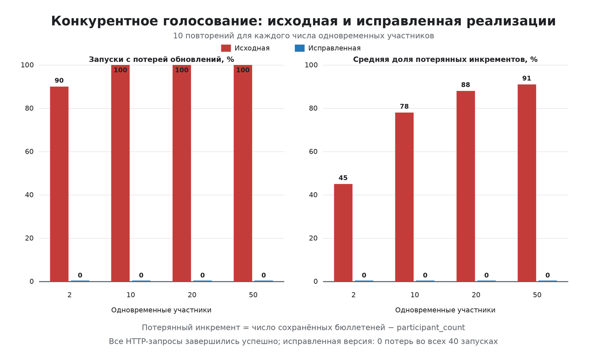

# Эксперимент с конкурентным голосованием

Проведены две серии по одной матрице конкурентности: 2, 10, 20 и 50
одновременных участников, по 10 повторений для каждого уровня. Исправленная
реализация испытана 26 октября 2026 года в 16:58:08 (UTC+3) на коммите
`c0d8646b7d7618a330c63ed9485f2ccef2b3d58a`. Исходная реализация испытана в
17:25:45 на предшествующем исправлению коммите
`27032be7d714ea303d47a98c30599e78ff9183de`.

В обеих сериях измеряемый интервал включал только одновременные HTTP-запросы
голосования. Регистрация пользователей и создание опроса выполнялись до начала
измерения. Запросы запускались через общий асинхронный барьер. Каждый запуск
использовал новый опрос, а состояние проверялось напрямую в PostgreSQL после
завершения всех запросов. Разминка отдельно не проводилась, результаты первых
запусков не исключались.

## Сравнение корректности

| Участники | Запуски с потерями, исходная | Запуски с потерями, исправленная | Средняя потеря `participant_count`, исходная | Средняя доля потерь, исходная | Средняя доля потерь, исправленная |
|---:|---:|---:|---:|---:|---:|
| 2 | 9/10 (90%) | 0/10 (0%) | 0,9 из 2 | 45% | 0% |
| 10 | 10/10 (100%) | 0/10 (0%) | 7,8 из 10 | 78% | 0% |
| 20 | 10/10 (100%) | 0/10 (0%) | 17,6 из 20 | 88% | 0% |
| 50 | 10/10 (100%) | 0/10 (0%) | 45,5 из 50 | 91% | 0% |

В исходной реализации все 820 запросов завершились HTTP-статусом 200 и все 820
бюллетеней сохранились, однако счётчики разошлись с бюллетенями в 39 из 40
запусков. В исправленной реализации все 820 запросов также завершились успешно,
а число бюллетеней, `participant_count` и `vote_count` совпало во всех 40
запусках. Расхождение рассчитывается как `число бюллетеней - значение счётчика`.

Средняя доля потерь вариантов в исходной реализации составила 45%, 75%, 88,5%
и 89,6% соответственно. Небольшое различие между потерями `participant_count`
и `vote_count` объясняется тем, что исходный ORM-код обновлял эти строки
независимо. Исправленная реализация не потеряла ни одного обновления обоих
счётчиков.

## Время выполнения

| Участники | Среднее время пакета, исходная, мс | Среднее время пакета, исправленная, мс |
|---:|---:|---:|
| 2 | 29,12 | 39,59 |
| 10 | 206,47 | 220,32 |
| 20 | 396,47 | 379,70 |
| 50 | 662,45 | 723,82 |

Серии выполнялись последовательно, без отдельной разминки и рандомизации
порядка, поэтому эти значения подходят для описания условий эксперимента, но не
для вывода о производительности. Вывод о корректности основан на состоянии базы
данных после каждого из 80 запусков.

Окружение:

- Python 3.12.14;
- FastAPI 0.115.12;
- SQLAlchemy 2.0.41;
- HTTPX 0.28.1;
- PostgreSQL 16.15;
- Linux x86_64, облачная изолированная среда.

Файлы:

- `concurrency_experiment_original.csv` — 40 исходных запусков;
- `concurrency_experiment_original_summary.csv` — сводка исходной реализации;
- `concurrency_experiment_original.md` — отчёт исходной серии с окружением;
- `concurrency_experiment_fixed.csv` — 40 запусков после исправления;
- `concurrency_experiment_fixed_summary.csv` — сводка исправленной реализации;
- `concurrency_experiment_fixed.md` — отчёт исправленной серии с окружением;
- `concurrency_comparison.csv` — данные сопоставления двух реализаций;
- `concurrency_comparison.svg` и `concurrency_comparison.png` — график в
  векторном и растровом форматах.
